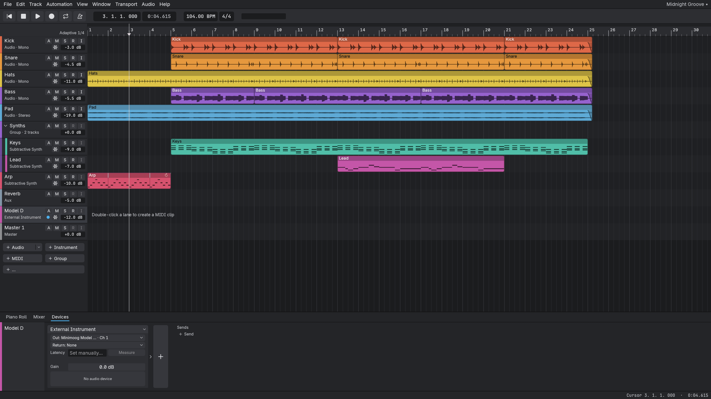
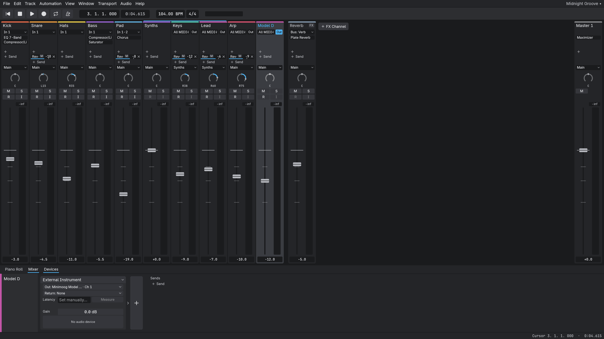
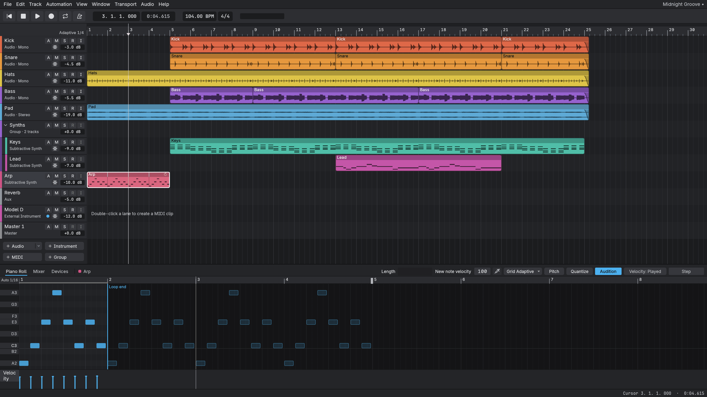

<p align="center">
  <picture>
    <source media="(prefers-color-scheme: dark)" srcset="assets/brand/transit-wordmark-white.svg">
    <source media="(prefers-color-scheme: light)" srcset="assets/brand/transit-wordmark-graphite.svg">
    
  </picture>
</p>

<p align="center"><strong>An open-source DAW in Rust with native ASIO, measured latency, and plug-ins that cannot freeze the window.</strong></p>

<p align="center">
  <a href="https://github.com/transit-audio/transit/actions/workflows/ci.yml"></a>
  <a href="https://discord.gg/7PPUBZqA66"></a>
  <a href="https://github.com/transit-audio/transit/releases/latest"></a>
  <a href="#license"></a>
  <a href="https://github.com/transit-audio/transit/releases"></a>
</p>

A desktop DAW in pure Rust with Ableton/Logic-style ergonomics and its own audio engine, device
layer and egui UI. transit began in October 2026 as a fork of
[SoundCraft](https://github.com/storytold/soundcraft) and has diverged since; the lineage is
credited in About and in NOTICE.

> [!NOTE]
> transit is alpha software under active development; the current release is [v0.3.0](https://github.com/transit-audio/transit/releases/tag/v0.3.0) (see [Downloads](#downloads)). transit checks once a day for a newer release with one anonymous request to GitHub and tells you; turn it off in the Help menu or with `TRANSIT_NO_UPDATE_CHECK=1` ([details](docs/building.md#the-update-check)). The current priority is core engine
> correctness, stability and performance, measured on real hardware, ahead of new features.
> Expect rough edges in the UI and some missing features; the audio engine, recording alignment
> and device handling get fixed first, following [the engineering principles](docs/principles.md).
> Releases are frequent, and each lists its
> [known issues](docs/known-issues/README.md). Measurements and bug reports are the most valuable
> help right now: see [How to help](#how-to-help).

## Why transit

- A native ASIO backend written from the protocol up, without the Steinberg SDK.
- Latency you can measure in the app, not just read off a box.
- Plug-in loading that cannot freeze the window.
- Ableton and Logic ergonomics on a measured engine.

## Downloads

The current release is [v0.3.0](https://github.com/transit-audio/transit/releases/tag/v0.3.0). The files are `transit-v0.3.0-windows-x86_64.msi` and `.zip`, `transit-v0.3.0-macos-arm64.dmg` and `.tar.gz`, `transit-v0.3.0-linux-x86_64.tar.gz`, and `transit-v0.3.0-linux-x86_64.AppImage`, `.deb` and `.rpm`.

- **Windows (x86_64):** one download, the `.zip` (portable) or the `.msi` (installer with the standard install dialogs and license; it registers `.transit` and `.transitz`). It has native WASAPI and native ASIO.
- **macOS (Apple silicon):** the `.dmg`; open it and drag `transit.app` to Applications.
- **Linux (x86_64):** the tarball; unpack it and run `transit`. Each release also carries an `.AppImage`, a `.deb` and an `.rpm` (see [Linux](#linux)).

The builds are unsigned. On Windows, SmartScreen shows "More info", then "Run anyway". On macOS, if the app is blocked, run `xattr -dr com.apple.quarantine /Applications/transit.app` or right-click it and choose Open.






## Linux

Each release has an `.AppImage` (any recent distribution: `chmod +x` it and run it), a `.deb` (Debian, Ubuntu, Mint) and an `.rpm` (Fedora, openSUSE), next to the tarball. They are unsigned.

To build, install `libasound2-dev pkg-config`, plus `libjack-jackd2-dev` to build with `--features native-jack` ([docs/building.md](docs/building.md#native-jack-backend-linux)).

**PipeWire.** Through ALSA, PipeWire runs the stream at its own quantum, not at the buffer size chosen in Audio Devices. When the two differ, the window shows both ("Requested 128 · running at 256"); the second figure is the real one. To change it, set PipeWire's quantum, for example `pw-metadata -n settings 0 clock.force-quantum 128` (`0` puts it back), then Reconnect.

**Native JACK/PipeWire backend.** It talks to JACK, or to PipeWire through its JACK library, so the server's quantum is the only figure. The Linux release builds carry it; Auto prefers it when a JACK or PipeWire server is running. On Debian and Ubuntu with PipeWire, start transit as `pw-jack transit` so PipeWire's JACK library is found. It is new and untested on most hardware, so testers are wanted ([#55](https://github.com/transit-audio/transit/issues/55)).

Run `transit --report` and attach the file it writes: it lists your distribution, kernel, PipeWire or JACK versions, the devices transit sees and the end of the log (your user name is hidden, and it opens no audio device). Using a Linux interface? Tell us which, with distribution, kernel, server and buffer size, in [#49](https://github.com/transit-audio/transit/issues/49).

## How to help

Join the Discord for announcements, testing reports and questions: [Discord invite](https://discord.gg/7PPUBZqA66)

transit is measured on real hardware, and the bench has only two Windows interfaces on it. Loopback
measurements from other machines are the most useful contribution right now.

### What we are looking for

- macOS with any Core Audio interface. We have no Mac; aggregate devices especially.
- Linux with ALSA, JACK or PipeWire.
- Windows with an interface other than the Focusrite Scarlett 2i2 or TASCAM Model 12 (RME, MOTU, Universal Audio, Behringer, Audient, PreSonus, SSL, onboard Realtek), on both its ASIO and its WASAPI path.
- Multichannel interfaces in general.

### What to run

`audio-bench` plays clicks out of one output and finds them again on one input. Cable one output
of your interface into one input of the same interface, turn the monitors down, set the input gain
to about the middle and the input to Line/Inst, and close other audio apps. From the next release
the bench ships in every release zip; until then build it with `cargo xtask audio-bench` (see
[docs/benchmarks](docs/benchmarks/README.md)). List your devices first (`--list-devices --system WASAPI`
or `--system ASIO`), then run, with your own names and channels:

```
audio-bench --backend cpal --system WASAPI --device "<output>" --in-device "<input>" --loopback --out-ch 1 --in-ch 1 --seconds 10 --out results.md
audio-bench --backend wasapi --loopback --out-device "<output>" --in-device "<input>" --out-ch 1 --in-ch 1 --seconds 10 --out results.md
audio-bench --backend asio --device "<ASIO driver>" --loopback --out-ch 1 --in-ch 1 --seconds 10 --out results.md
```

The first is shared WASAPI through cpal; on macOS and Linux use the platform's default system the
same way. The second is transit's native WASAPI backend and the third is ASIO, both Windows only.

### What to send

- The table row the bench prints, and the `render backend:` and `capture backend:` lines under it.
- The interface, driver version, OS build and CPU, and whether all the clicks were detected.

File it with the [measurement issue template](https://github.com/transit-audio/transit/issues/new?template=measurement.md)
or wherever you find us. <!-- TODO(owner): add the Discord invite here; the repo names none yet. -->

### Help wanted by platform

Most development happens on Windows. If you run Linux or macOS, the issues below need someone with your machine:

- Linux: [help wanted, platform:linux](https://github.com/transit-audio/transit/issues?q=is%3Aissue+is%3Aopen+label%3A%22help+wanted%22+label%3Aplatform%3Alinux)
- macOS: [help wanted, platform:macos](https://github.com/transit-audio/transit/issues?q=is%3Aissue+is%3Aopen+label%3A%22help+wanted%22+label%3Aplatform%3Amacos)
- Everything marked help wanted: [all help wanted issues](https://github.com/transit-audio/transit/issues?q=is%3Aissue+is%3Aopen+label%3A%22help+wanted%22)

Found a problem? [Troubleshooting](docs/troubleshooting.md) says where the log file is, how to turn on more detail (Help > Debug Logging, `--verbose`) and what to include in a report.

Issues labeled good first issue are scoped and documented enough to start with. Hardware reports (interface, driver, buffer, measured round trip) are welcome on any platform: open an issue with the numbers.

### Other ways to help

- Try the latest release and report what breaks, with the steps to make it happen.
- Read the [known issues](docs/known-issues/README.md) and pick one.
- Review an [ADR](docs/adr) draft when one is posted.
- Working with AI coding agents? Read [Working on transit with AI coding agents](docs/contributing/agents.md).

## Documentation

- [User guide: appearance and interface size](docs/user-guide.md)
- [Keyboard shortcuts reference](docs/shortcuts.md)
- [Troubleshooting](docs/troubleshooting.md)
- [Building and running transit](docs/building.md)

## Features

### Arrangement

- Adaptive grid down to 1/128, with Ctrl+1-4 for narrower, wider, triplet and snap on/off.
- Clips snap to the grid as you drag; Ctrl-drag or Alt-drag copies; Shift bypasses snap.
- Loop strip on the ruler, in amber: drag to make a loop, drag its edges to resize it, double-click to toggle it. The loop follows tempo changes.
- Automation lanes under any track for volume, pan, mute, sends and every device parameter; Read, Touch, Latch and Write modes.
- Tempo and meter changes along the timeline, edited by dragging or typing in the transport.
- Transport metronome button: right-click for click level and count-in bars. Count-in works at bar 1, and recording starts sample-exact at the end of it.
- Transport load readout (for example "30%  128 @ 48 kHz  ASIO") with an overload warning.
- The Play button dims and pulses while Play is pending or plug-ins are still loading; hover it for the reason.
- Piano roll with a velocity lane, and step entry: play notes on your keyboard to enter them at the cursor. Keys you play live are accented on the piano roll's keyboard. It shares the adaptive grid (Ctrl+1-4), with step-cursor keys and a fixed-velocity setting. Tap Tie/Rest (the sustain pedal by default, or Tab/Enter) while holding keys to lengthen the notes, or with nothing held to enter a rest; a preference turns hold-to-lengthen off so lengths come only from taps.
- Quantize in the piano roll: a Quantize button opens grid, strength and swing controls plus a note-end option, with an outlined preview before you apply. Apply is one undo step, and Ctrl+U reuses the saved settings.
- Scale mode in the piano roll: pick a key and scale to highlight it, fold the view to the scale (accidentals stay inline), and edit by scale degree; a chord with an accidental keeps its shape when moved by a degree. Live input is never snapped. The key and scale list is Ableton's (major, minor, the modes, pentatonics, blues, harmonic and melodic minor and more) in a Root grid and a scrollable list.
- Controller lanes in the piano roll: edit CC lanes and sustain-pedal regions; a take that holds only the sustain pedal is kept. Each edit is one undo step.
- Note length in the piano roll: Alt-drag a note's edge to set a length shorter than the grid, Alt+Shift-drag a body to move it without snap (Alt-drag a body changes velocity), and a numeric Length field in the inspector. Shift snaps; in scale mode it overrides to chromatic.
- Freeze, Unfreeze and Flatten a track (the snowflake on the track header); a frozen track plays its rendered audio, with its key sources running.
- Group tracks: Track > New Group Track or the "+ Group" quick-add; Ctrl+G folds the selected tracks into a group, Ctrl+Shift+G ungroups, and you can drag track headers into a folder. Edit Group… is the separate edit-group feature.
- Fade and crossfade handles on audio clips: hover a top corner and drag for length (Shift: no snap), Alt-drag to bend, click for the shape menu, double-click to reset; right-click overlapping clips for Crossfade.
- Clip-internal loops: drag the loop handle at a clip header's upper right to repeat the clip in cycles (dividers show each cycle; Alt-drag makes independent copies, Ctrl/Cmd-drag overwrites the clips in the way). Edits inside the loop apply to every cycle.

### Mixer and routing

- Per-track device chains: drag a device to reorder the chain; Alt-drag copies it.
- Buses and sends, with a warning for routes that point nowhere and a refusal for routing loops.
- Sidechain any compressor or gate from any track or bus, pre- or post-fader, latency-aligned.
- Hosted plug-ins can take a sidechain key too.
- Plug-in delay compensation keeps every path time-aligned.
- Opens every output on your interface; name your own paths and route tracks, buses and sends to any of them.
- Hardware inserts: send a track through outboard gear on your interface. Choose "Hardware Insert..." in the device chain's "+" menu, then pick a send path and a return path (a pair) on the insert. Audio Devices > I/O > Hardware inserts has a Measure button that plays a click train and records the round trip, which delay compensation then uses so the track stays aligned. Measure runs in the background with a progress count (n/8 clicks) and a Cancel button, so the UI stays responsive. Transport starts (Play, Record, Space) are refused while a measurement runs, and re-opening the audio device cancels it at once. The insert shows Ready, Unmeasured, No input, Missing send, Missing return or Disabled, with the reason. A route to a path an insert sends on is refused.

### Instruments and effects

- Hosts CLAP and VST3 plug-ins, with their own editor windows, saved state, and reported latency.
- The plug-in window header has a preset dropdown (Save, Save As…, Load…, previous/next), Bypass and a menu (Reset, Copy/Paste state, Delete, Show in chain). User presets are `.vstpreset` files other hosts can read.
- Plug-in editors scale with the display: VST3 and CLAP editors receive the window's content scale, rescale when dragged between monitors with different scaling, and CLAP editors are sharp embedded and floating.
- The device card shows Loading while a heavy plug-in instantiates.
- Plug-ins load on a host thread, so a slow or stuck plug-in no longer freezes the UI: its slot reads "Loading…" while it instantiates and "Not responding" if it stops answering. A slow load shows how long it has taken, the phase it is in and how long it took last time; the status line reports loads and editor opens over 2 s.
- Plug-in browser with a background scan and your own search folders.
- Built-in instruments: Subtractive Synth, Drum Synth, Sampler. All built-ins open an editor window: parameter rows, Sampler load or drop, Drum Synth by pad.
- Built-in panels with knobs, and bespoke layouts for Compressor, Gate, EQ, Synth and Plate; factory and user presets; a scope and a gain-reduction display on the dynamics panels. Moving a plug-in knob while a lane is armed (Write, Latch, Touch) records into it.
- Built-in dynamics and EQ: Compressor/Limiter, Expander/Gate, De-Esser, Maximizer, Channel Strip, EQ 7-Band, EQ 1-Band.
- Built-in effects: Room and Plate Reverb, Mod Delay, Chorus, Flanger, Phaser, Saturator, Lo-Fi, Rectifier, Pitch Shifter.
- Utilities: Gain, Trim, Invert, Time Shift, DC Offset Removal, Signal Generator, Dither.

### MIDI

- Play hosted instruments live from a USB controller; on Windows it uses the native WinMM driver.
- Window > MIDI Monitor: every message from every input port (routed or not) and every message sent to an output port, with filters by direction, device, channel and type, text search, a per-port Clock BPM and message-rate readout, Learn (see what a control sends) SysEx bytes in the rows, a transport-position Time column while playing, and a bug-report copy. A "MIDI" light at the right of the transport bar blinks on input.
- MIDI Learn: right-click a fader, pan knob, mute, solo, record arm or send level, choose MIDI Learn and move a knob or press a key on any open controller. Knobs pick the control up as they cross its value (or jump, per mapping) over a range you set; notes and buttons toggle. Mappings live in the session or in a per-machine controller profile (the session wins a conflict); mapped controls carry a small marker and Window > MIDI Mappings lists, edits, re-learns and deletes them. A mapped sweep is one undo step. Plug-in parameters map the same way, built-in or hosted: right-click a knob in a built-in plug-in's editor, or use the hosted editor header's *MIDI Learn: next touched parameter* and move the control in the plug-in; the knob spans the parameter's own range, a hosted VST3 parameter follows the plug-in's own curve, and in Write, Latch or Touch a mapped move is recorded as automation, in Read it is applied but not written.
- MIDI Learn takeover: a mapped knob that is not where its control is takes over scaled by default (the control moves proportionally until they meet); a per-machine setting, in the mappings window or a mapped control's menu, switches to jump (straight to the knob) or pickup (wait until the knob reaches the control).
- Input without usable timestamps is still played, with approximate timing, rather than dropped.
- External MIDI output per MIDI track: the mixer strip's Out button picks Instrument or a hardware MIDI port, a channel and a millisecond offset. Notes and controllers follow the playback clock (clip loops included), live input echoes while armed or monitoring, and All Notes Off is sent on stop, loop wrap, disarm, unplug and exit.
- MIDI feedback protection: live input is not echoed back to the device it came from (a controller with MIDI thru would loop) unless the Out menu's "Allow echo to this device" is on, channel-mode messages are never echoed, and an input port caught in a feedback loop is muted (recording from it stops too) until you re-enable it from the track's MIDI input menu or the External Instrument card.
- External Instrument: choose "External Instrument" in an instrument track's instrument menu to play a hardware synth. Its MIDI goes to the port on the Out button, its audio comes back on an input you pick on the card, with a gain and a latency in ms that delay compensation uses to put the synth on the grid. A bounce asks before leaving it out (it can only be heard in real time). External MIDI on any track now follows delay compensation.
- External Instrument Measure: the card's Measure button plays a warm-up note and 8 notes to the synth and times their sound on the return, then keeps the median for that MIDI port, input, sample rate and buffer size on this machine (a value typed by hand still wins). Cancel, a refusal or a lost device always ends the note.
- Real-time render with hardware synths: Bounce can play a mix with an External Instrument through your audio interface in real time, so the file is what you hear, with the synth on the grid and, if you like, its return as a separate stem. Cancel stops the synth cleanly and writes nothing; "Render without hardware" stays as the faster offline choice.
- MIDI recording: arm an instrument track and record, with a count-in. Overdub merges into the clip under the pass. With Cycle on, Record loops the range and keeps going until Stop, each lap a stacked take (audio too; there is no separate Loop Record option); stopping mid-lap keeps the partial lap, and the status line reports the take count. Held notes are cut at the loop end and resume at the start of the next lap.
- A MIDI take journal is written during the pass and kept until an autosave that holds the recording lands; after a crash, the next launch recovers it as a `<Track>_recovered` clip. Record works without a validated device clock: alignment is approximate, a take recorded that way says so, and when recording cannot start you get a plain-English reason.
- A hosted plug-in that re-sends an unchanged parameter value no longer registers an automation touch; only a real change does.
- Update check: once a day, one anonymous request to GitHub; turn it off in the Help menu or with `TRANSIT_NO_UPDATE_CHECK=1`.
- The window and taskbar show the transit icon and identity.

### Audio devices

- Audio Devices window to pick the driver (WASAPI, or ASIO (the native ASIO backend)), device and buffer size.
- Audio Devices has a sidebar of sections (System, I/O paths, Hardware inserts) so every option fits a laptop screen. Changing the driver, backend, device, rate or buffer size is pending until you press Apply: the window says what will change, highlights Apply, and Revert (or Esc) puts the running choices back.
- Native JACK: the buffer size chosen in Audio Devices is asked of the server when transit connects (64 to 2048 frames; Linux packages arrive with the next release).
- Copy diagnostics (Audio Devices and Callback Telemetry) and `transit --report` write a text report of your system, devices and the end of the log, with your user name and paths redacted, to attach to a bug report.
- Named input and output paths, saved per machine.
- Native WASAPI backend (on by default; pick it under Audio Devices > Backend), with a cpal fallback. It plays, captures (filling any lost packets with zeros, so a take keeps its length) and runs duplex: an input is paired with its output by device, chosen with the Paired input selector. It opens the device shared by default; a "Take exclusive control of the device" checkbox opens it exclusive instead (other apps are silenced while transit runs), and an exclusive open that fails steps down to shared, with a message, rather than failing silently. `audio-bench --backend wasapi` measures it. Verified on a Scarlett 2i2 in shared and exclusive mode (a Model 12 run is pending). On Windows, native WASAPI gives any interface a dependable, calibrated stereo path with no SDK and no extra driver install. How many channels it sees is decided by the vendor's WDM driver: the TASCAM Model 12 registers one stereo playback and one stereo recording endpoint, so WASAPI shows 2 in and 2 out on it in every mode, and individual channels cannot be recorded over WASAPI. Multichannel and tracking-grade latency on Windows are the ASIO path (a native ASIO backend is in progress).
- Native ASIO backend (on by default; no Steinberg SDK and no LLVM): choose Audio system ASIO, then Backend > Native ASIO. It lists every installed driver and says which failed to load, opens every channel of the interface (all 12 inputs and 10 outputs of the TASCAM Model 12, named as the driver names them), plays, records and runs hardware inserts duplex, shows the buffer, sample format and latency the driver reports, and opens the driver's own settings (Driver settings). About 6 ms round trip on the Scarlett 2i2 at 64 samples.
- Loopback calibration: `audio-bench --backend wasapi --loopback --settings` measures the interface's round trip and saves it, and the timing label then reads "calibrated". Over native ASIO the Calibration line in Audio Devices has a Measure button: a click through a cable from an output to an input times the loop at the current buffer size and rate, recordings are placed from it, and the driver's own latency figures are shown beside it (until then they are used; on the Scarlett 2i2 at 48 kHz they are within about 5 frames of the measured loop). Shared mode is not a low-latency path (about 248 ms round trip on the Scarlett 2i2); exclusive mode measured about 223 ms there (and about 276 ms, often silent, on a Model 12), and ASIO about 23 ms, so ASIO remains the tracking path on that interface.
- `audio-bench --midi-roundtrip` measures MIDI-to-audio onset latency; the benchmarks page lists results for several interfaces.
- Tracks, buses and sends route to any output path, with latency aligned across them.
- Native ASIO recovers from a driver reset request (the driver changing its buffer size or sample rate) and reopens the device, and its audio thread runs at MMCSS Pro Audio priority.
- The Calibration Measure button works per driver, sample rate and buffer size, and keeps a result for each combination.
- Linux: native JACK/PipeWire backend (build with `--features native-jack`; `pw-jack transit` under PipeWire). It plays and records duplex in one server cycle at the server's rate and buffer size, counts the server's xruns, and reopens by itself when the server changes its buffer size or rate or comes back after stopping.
- Linux packages: an `.AppImage`, a `.deb` and an `.rpm` come with the tarball.
- Audio Devices shows "Requested 128 · running at 256" when the device runs a different buffer size or rate than you asked for.

### Sessions and rendering

- Bounce the main mix or any bus over the selection or loop range to WAV, AIFF or FLAC at 16-bit, 24-bit or 32-bit float.
- Stems by output path from the Bounce dialog.
- Bounce in Place turns a track's clips into audio.
- Full undo history; every edit is a command.
- Autosave, and sessions saved as versioned, human-readable JSON in `.transit` files.
- A launch splash that reports the audio device opening first, then plug-in scan progress, and Help > About with version info and a link to the transit repository.
- Import audio and MIDI files; export MIDI. File > Open Recent lists your last ten sessions (Ctrl+Shift+O).

### Under the hood

- An audio backend trait sits between the Player and the audio system, with cpal behind it as the first adapter.
- One renderer: playback and offline render both use the plan renderer; the legacy renderer is gone.
- Offline render and playback are checked against each other by golden tests.
- Every edit is a named command, which is what makes undo and the command catalog uniform.
- Assistant access (the control server and MCP tools) addresses positions as bar|beat and can add chords.

## Status

Pre-alpha. The product is now called transit, and its settings folder moved from `transitDAW` to `transit` (your settings are moved once on first launch). Windows is tested daily and needs Windows 10 version 1607 or later; macOS and Linux build but are untested (their packaging ids are `dev.derekmwright.transit`). The packaging scripts under `packaging/` build the transit app on every platform ([docs/building.md](docs/building.md#packaging)). The Windows release is one download (zip and MSI) with native WASAPI and native ASIO.
Expect rough edges and breaking changes to the session format. Back up anything you care about.

## Build

You need a Rust toolchain at 1.90 or newer (`rust-version` in `Cargo.toml`). On Linux, install
`libasound2-dev` and `pkg-config` first.

Every pull request and push to `main` is checked with clippy, tests and the layer rules on Windows,
Linux and macOS, plus the web build and the ASIO and native WASAPI features. Hardware tests are
never CI gates.

```sh
cargo build -p transit --release
```

The binary is `target/release/transit` (`transit.exe` on Windows). On Windows this plain build includes Native WASAPI and Native ASIO (default features; they do nothing on Linux and macOS). `--no-default-features` leaves them, and the update check, out.

### ASIO on Windows

The native ASIO backend (`crates/audio-asio`) is part of the default Windows build and needs nothing
beyond the Windows prerequisites: no SDK, LLVM or environment variables. Choose Audio system ASIO,
then Backend "Native ASIO" in Audio Devices. Details and the hardware tests:
[docs/building.md](docs/building.md#building-with-asio-windows).

## Run

```sh
cargo run -p transit --release            # empty session
cargo run -p transit --release -- --demo  # built-in demo song
transit --version
```

Settings, autosaves and logs live in a per-user folder: `%APPDATA%\transit` on Windows,
`~/Library/Application Support/transit` on macOS, `$XDG_CONFIG_HOME/transit` (or
`~/.config/transit`) elsewhere. Set `TRANSIT_CONFIG_DIR` to use another folder. An empty value
disables saving settings.

`transit --control <port>` (or `TRANSIT_CONTROL_PORT`; `0` picks a free port) starts a JSON-lines control server for scripts and the MCP server. It binds to `127.0.0.1` only. At start it writes a random per-run token to `control-token` in the settings folder (override the path with `TRANSIT_CONTROL_TOKEN_FILE`) and logs the path; each connection must send `auth <token>` as its first line or it is closed. `soundcraft-cli mcp --connect <port>` reads the file itself. The MCP tools are `list_commands`, `execute`, `batch`, `inspect_session`, `new_session`, `open_session`, `save_session`, `import_audio`, `bounce_mix`, and, with the app, `screenshot`, `ui_inspect`, `ui_set`, `click`, `drag` and `key`. See `docs/control-protocol.md` and `docs/mcp.md`.

## Status and known issues

- Pre-alpha; the session format and UI change freely.
- A heavy plug-in can still block the UI for the duration of its single create call.
- Approximate record alignment on devices whose clock never validates can differ by up to one input block (K14); Freeze renders a fixed 2 second tail.
- The Windows release is one download (zip and MSI) with native WASAPI and native ASIO. It is unsigned: SmartScreen shows "More info", then "Run anyway".

What comes next, by milestone: [docs/roadmap.md](docs/roadmap.md).

## Lineage

transit began in October 2026 as a fork of [SoundCraft](https://github.com/storytold/soundcraft) by
storytold, an open-source Rust digital audio workstation. transit has its own audio engine (native
WASAPI and native ASIO backends) and its own product direction; the plug-in hosts and a number of
crates were inherited and keep their `soundcraft-*` names until they are renamed. Engine fixes that
apply upstream may be offered back.

## License

MIT OR Apache-2.0, at your option: see [LICENSE-MIT](LICENSE-MIT), [LICENSE-APACHE](LICENSE-APACHE)
and [NOTICE](NOTICE).

## Contributing

Issues are welcome; see [CONTRIBUTING.md](CONTRIBUTING.md). Background on past decisions is in the [ADR index](docs/adr/README.md).

## For contributors and their agents

- [AGENTS.md](AGENTS.md): read this first.
- Crates we own are `transit-*`; inherited ones are still `soundcraft-*` ([ADR 0014](docs/adr/0014-transit-gets-its-own-repository.md)).
- [docs/adr/](docs/adr/README.md): architecture decisions.
- [docs/contributing/](docs/contributing/README.md): evidence and knowledge notes.
- [docs/known-issues/](docs/known-issues/README.md): accepted, tracked limitations.

ASIO is a trademark of Steinberg Media Technologies GmbH, registered in Europe and other countries.
